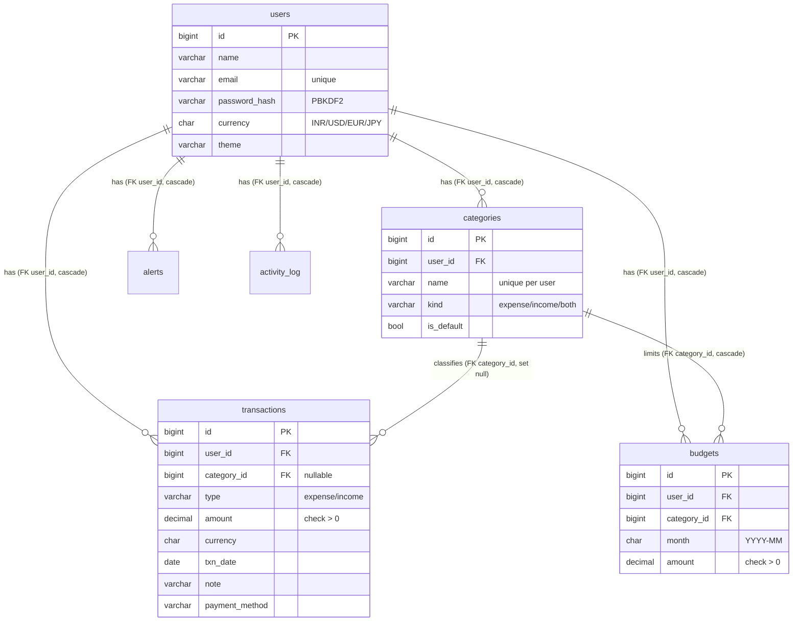

# Ledgerline — Expense Tracker in Pure Java 17

A complete, working personal expense tracker built with **plain Java 17 only**:
the JDK's built-in `HttpServer`, plain JDBC (`PreparedStatement`), HTML generated
from Java text blocks, and charts drawn as inline SVG by Java code.
No Spring, no frameworks, no JavaScript.

This is a **second-year B.Tech (IT) college project** for the Java and DBMS
subjects. Every syllabus concept is used visibly in the code and called out
in comments — see [Syllabus mapping](#syllabus-mapping) and
[Explaining it in a viva](#explaining-it-in-a-viva).

## Features

| Area | What it does |
|---|---|
| **Auth** | Sign up / log in / log out. PBKDF2 password hashing (salted, never plain text). Sessions in a `HashMap`, HttpOnly cookies, 30-min sliding expiry |
| **Transactions** | Full CRUD for income & expenses: amount, category, date, note, payment method, currency |
| **Categories** | 7 defaults (Food, Travel, Rent, Shopping, Bills, Education, Other) + your own custom categories |
| **Budgets** | Monthly limit per category. Exceeding it throws the custom `BudgetExceededException` → warning banner; a background thread also raises dashboard alerts |
| **Dashboard** | Income / expense / balance, category donut chart, 6-month trend bars, recent transactions, budget alerts, undo-delete |
| **Search & filter** | By date range, category, type, free text; sort by date or amount |
| **Currency** | `CurrencyConverter` interface with INR/USD/EUR/JPY implementations; totals shown in your chosen currency (fixed demo rates) |
| **CSV** | Export all transactions; import from pasted CSV with per-row validation |
| **Backup/restore** | Whole-dataset backup via Java serialization (`.ser` files), recursive backup listing; restore runs in **one DB transaction** (`Db.inTransaction` + `setAutoCommit(false)`) |
| **Undo** | Last delete restorable — history in a hand-written doubly linked list |
| **Reports** | Date-range analytics: breakdown donut, trend bars, top categories, avg spend/day |
| **Validation** | Server-side everywhere; friendly messages instead of stack traces |
| **Theme** | Light/dark via CSS variables, responsive mobile → desktop |

## Quick start

### 1. Prerequisites

- Java 17+, Maven 3.8+
- MySQL 8 (or MariaDB 10.5+)

### 2. Database

```bash
# create the database + user (example)
mysql -u root -p -e "CREATE DATABASE expensetracker CHARACTER SET utf8mb4;
  CREATE USER 'etuser'@'localhost' IDENTIFIED BY 'change-me';
  GRANT ALL ON expensetracker.* TO 'etuser'@'localhost';"

# create the tables (the app also creates them automatically on first boot —
# see the note below; the *database itself* must already exist)
mysql -u etuser -p expensetracker < schema.sql
```

> **Note:** on startup the app runs `Db.initSchema()`, which executes `schema.sql`
> (`CREATE TABLE IF NOT EXISTS`) — so the tables create themselves. But JDBC
> connects *to* the `expensetracker` database, so the database (and user) must
> be created first, as above.

### 3. Configure (environment variables — never hardcoded)

```bash
cp .env.example .env   # then edit, or export directly:
export DB_HOST=localhost DB_PORT=3306 DB_NAME=expensetracker
export DB_USER=etuser DB_PASSWORD=change-me
export APP_PORT=8080
# DB_SOCKET=/tmp/mysql-bridge.sock  # only for sandboxed dev environments
                                    # where the JVM can't open TCP (see below)
```

### 4. Build & run

```bash
mvn package                 # builds target/expense-tracker-1.0.0.jar (fat jar)
java -jar target/expense-tracker-1.0.0.jar
# open http://localhost:8080
```

### 5. Tests

```bash
mvn test   # unit tests always run; DAO tests run when MySQL is reachable
```

### Docker

```bash
docker build -t ledgerline .
docker run -p 8080:8080 \
  -e DB_HOST=host.docker.internal -e DB_USER=etuser -e DB_PASSWORD=change-me \
  ledgerline
```

### Sandboxed development (Unix-socket DB access)

This project was developed in a sandbox where the JVM could not open raw TCP
connections — even to `localhost`. The workaround, kept in the repo as an
optional aid:

1. A tiny Python sidecar (`~/tools/mysql-bridge.py`, not part of the app)
   listens on a Unix socket and forwards bytes to MySQL over TCP.
2. `dao/UnixSocketFactory.java` is a Connector/J `SocketFactory` that connects
   through that Unix socket (via a `SocketImpl` delegating to a
   `SocketChannel`).
3. `Db.jdbcUrl()` appends `socketFactory=…UnixSocketFactory` when the
   `DB_SOCKET` env var is set.

On any normal machine leave `DB_SOCKET` unset and the app uses plain TCP —
nothing else changes. This is a good viva story about adapting to
environment constraints with a clean, documented seam.

## Project layout

```
src/main/java/com/expensetracker/
├── model/        User, Transaction (abstract), Expense, Income,
│                 Category, Budget, Alert            # Week 2, 3
├── exception/    BudgetExceededException, InvalidAmountException,
│                 ValidationException                # Week 4
├── util/         Passwords, Validation, Html, Svg, Result<T> (generic),
│                 UndoList (doubly linked list), BackupFiles (recursion)  # Wk 6,8,9
├── dao/          Db, UserDao, CategoryDao, TransactionDao,
│                 BudgetDao, AlertDao, ActivityLogDao,
│                 UnixSocketFactory (optional sandbox aid) # Week 12 (JDBC)
├── service/      AuthService, SessionStore (HashMap), BudgetService,
│                 CurrencyConverter (interface) + 4 implementations,
│                 ConverterFactory, CsvService, BackupService (serialization),
│                 UndoService, ActivityLogService (producer-consumer),
│                 AlertWatcher (background thread)    # Week 3,5,6,7
└── web/          App (main), AppContext, BaseHandler, LandingHandler,
                 StaticHandler, pages/* (one handler per page)  # Week 2
src/main/resources/
├── schema.sql    # tables: users, categories, transactions, budgets, alerts, activity_log
└── static/style.css
```

## ER diagram



## The dashboard queries (JOIN + GROUP BY + aggregates)

`schema.sql` documents three sample analytics queries; the DAO layer implements them:

1. **Category spend** — `JOIN transactions → categories`, `GROUP BY` name, `SUM(amount)` → the donut chart data (`TransactionDao.spendByCategory`, Q1).
2. **Monthly trend** — `GROUP BY DATE_FORMAT(txn_date,'%Y-%m')` with conditional `SUM(CASE WHEN …)` for income vs expense, plus `COUNT(*)` and `AVG(amount)` (`TransactionDao.monthlyTrend`, Q2).
3. **Budget progress** — `JOIN budgets → categories` with a correlated subquery `SUM` for actual spend (`BudgetDao.listByMonth`, Q3).

> **Currency rule (important for the viva):** budgets are **always stored in
> INR** (`BudgetService.setBudget` converts the entered amount via
> `ConverterFactory`). Spend is also computed in INR — the SQL sums each
> transaction multiplied by its currency's fixed rate (`CASE currency WHEN
> 'USD' THEN 83.20 …`), mirroring the Java `CurrencyConverter` rates. Pages
> then convert INR → the user's display currency for showing. One base
> currency everywhere = no mixed-currency comparison bugs.

## Syllabus mapping

| Week | Concept | Where it lives |
|---|---|---|
| 2 | Packages, multiple classes, constructors, OOP | `model/`, `dao/`, `service/`, `web/`, `util/`, `exception/` — e.g. `User`, `Category` |
| 3 | Abstract class | `model/Transaction` (abstract `describe()`, `getSignedAmount()`), extended by `Expense` / `Income` |
| 3 | Interface + implementations | `service/CurrencyConverter` → `InrConverter`, `UsdConverter`, `EurConverter`, `JpyConverter`; `ConverterFactory` registry |
| 4 | Custom exceptions, try/catch/finally | `exception/BudgetExceededException` (thrown by `BudgetService.checkAfterAdd`, caught in `TransactionPages`), `InvalidAmountException`, `ValidationException` |
| 4 | `NumberFormatException`, `ArithmeticException` | `util/Validation.parseAmount` catches `NumberFormatException`; `Budget.percentUsed()` and reports guard division by zero |
| 5 | Multithreading | `App`: `HttpServer` on `Executors.newFixedThreadPool(16)`; `AlertWatcher` background thread; `SessionStore` cleanup thread |
| 5 | Producer–consumer | `service/ActivityLogService`: `LinkedBlockingQueue` + single consumer thread batch-writing `activity_log` |
| 6 | File I/O, CSV | `service/CsvService` export/import |
| 6 | Recursive directory listing | `util/BackupFiles.collectRecursive` lists `backups/*.ser` |
| 7 | Serialization | `service/BackupService.UserBackup` via `ObjectOutputStream`/`ObjectInputStream` |
| 7 | HashMap / Hashtable | `service/SessionStore` (`ConcurrentHashMap` token→session), `UndoService` histories map, `ConverterFactory` lookup map |
| 8 | Generics | `util/Result<T>` (the `Box<T>` idea); autoboxing in totals (`BigDecimal`/`double`/`long`) |
| 8 | Collections | `ArrayList`, `HashMap`, `TreeMap` (sorted category grouping), `HashSet`-style dedup via `Set`, `LinkedList`-backed `LinkedBlockingQueue` across `dao`/`service`/`web` |
| 9 | Doubly linked list | `util/UndoList<T>` — hand-written `Node` with `prev`/`next`, `insert`/`delete`/`display`; used by `UndoService` |
| 12 | JDBC: connection, DDL, CRUD | `dao/Db` + all `*Dao` classes — `PreparedStatement` everywhere, generated keys, batch inserts, transactions |

## Explaining it in a viva

**"Walk me through adding an expense."**
`TransactionPages.TransactionHandler` (POST `/transactions`) → `formParams` parses the
form → `buildFromForm` validates (amount via `Validation.parseAmount`, date, category)
→ `TransactionDao.create` runs an `INSERT` with `PreparedStatement` → back in the
handler, `BudgetService.checkAfterAdd` throws `BudgetExceededException` if the monthly
budget is crossed → caught, and the user is redirected with a warning banner (the
expense is still saved — it's a warning, not a block).

**"How does login work?"**
`AuthService.login` looks up the user by email (`UserDao.findByEmail`), verifies the
password with `Passwords.verify` (PBKDF2, constant-time compare), then
`SessionStore.create` puts a random 32-byte token → `Session` in a `ConcurrentHashMap`
and the handler sets an `HttpOnly; SameSite=Lax` cookie. Every later request looks
the token up; sessions expire after 30 idle minutes (plus a sweeper thread).

**"Where is polymorphism?"**
`Transaction` is abstract with `describe()` and `getSignedAmount()`; `Expense`
negates the amount, `Income` keeps it positive. `TransactionDao.map` builds the right
subclass from the `type` column. Same idea with `CurrencyConverter`: one interface,
four currency classes, used through `ConverterFactory` without `instanceof`.

**"How do budgets warn me?"**
Two paths: (1) synchronous — `checkAfterAdd` throws `BudgetExceededException` right
after an expense is saved; (2) background — `AlertWatcher` (daemon thread, every
10 min) scans all budgets and inserts into `alerts`, shown as a banner on the
dashboard (deduped while unread).

**"What happens on undo?"**
`UndoService.delete` removes the row via `TransactionDao.delete` (which returns the
deleted object) and `insert`s it into a per-user `UndoList` — a hand-written doubly
linked list. "Undo" `delete`s (pops) the tail node and re-inserts the transaction.

**"How is my data isolated from other users?"**
Every DAO query includes `WHERE user_id = ?`; the id comes from the server-side
session, never from the request. Backup/restore refuses files that don't belong to
the user; all rendered text goes through `Html.esc` (XSS protection).

## Screenshots

Screenshots aren't checked into the repo (no headless browser was available in
the build environment). Run the app and visit these pages to capture your own
for the project report:

- `/` — landing page (light theme)
- `/dashboard` — totals, SVG donut + trend charts, alerts
- `/transactions` — filterable list
- `/budgets` — budget progress cards
- `/reports` — analytics for a date range
- `/settings` — currency + theme (try the dark theme)

## What's intentionally simple (and why)

- **Fixed demo exchange rates** (`UsdConverter` etc.) — a real app would call an FX API; the interface makes that a drop-in change.
- **One JDBC connection per DAO call** — fine for this scale; a pool (HikariCP) would be the production step.
- **Sessions in memory** — restarting the server logs everyone out; fine for a college project.
- **Backups on local disk** (`backups/`) — listed recursively per the syllabus.

## License

MIT — college project, use it freely.
